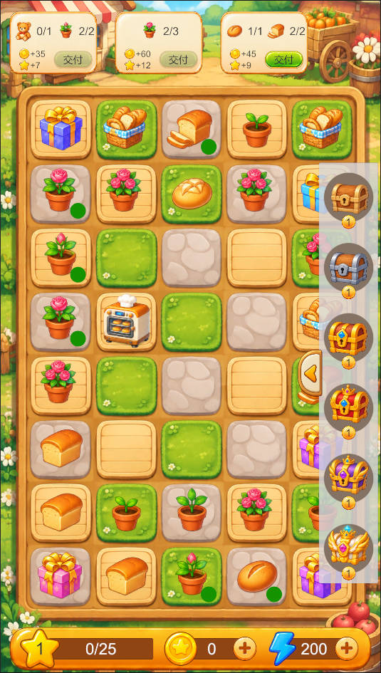
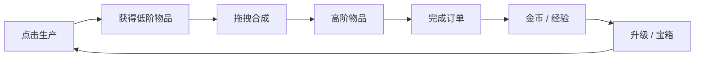

# MergeProject

**基于团结引擎（Tuanjie / Unity 2022.3 LTS）的 2D 合成经营游戏原型**

拖拽相同物品合成升级，点击生产设施获取新物品，完成订单换取金币与经验，再通过升级获得宝箱奖励。项目围绕「生产 → 合成 → 交付 → 成长」搭建了一套可运行、可扩展的合成游戏核心循环。

> A 2D merge-game prototype built with Tuanjie Engine (Unity 2022.3), featuring merging, production, orders, chests, and a data-driven item system.

**实机演示**：[B 站视频 · MergeProject](https://www.bilibili.com/video/BV1S3WB6QEmn)


<p align="center">
  
</p>

<p align="center">
  <sub>5 列 × 8 行棋盘 · 拖拽合成 · 资源掉落</sub>
</p>

## 游戏循环



## 核心玩法

- **合成棋盘**：5 列 × 8 行，共 40 个槽位。拖拽两个相同的物品即可合成下一级。
- **六阶物品**：每条合成链包含 1～6 级物品，等级越高，订单奖励越丰厚。
- **点击生产**：烘焙机等生产设施达到指定等级后，点击可消耗 1 点能量生产低阶物品。
- **生产冷却**：普通生产者次数耗尽后进入冷却，冷却结束自动补满次数。
- **订单交付**：按 `Q` 生成随机订单，收集指定物品后点击交付按钮换取金币和经验。订单只会从 `ItemType.Normal` 的链中抽取，当前为面包、花朵和玩具。
- **宝箱背包**：点击侧边按钮展开宝箱栏，可将宝箱放入棋盘；升级时会随机获得不超过当前等级的宝箱。
- **资源掉落**：合成成功后有一定概率在附近空槽生成经验、金币或能量物品。
- **成长反馈**：经验条、等级、金币、能量实时刷新，升级需求随等级增长。

## 已实现功能

| 模块 | 实现内容 |
| --- | --- |
| 合成棋盘 | 5×8 网格、槽位占用管理、最近空槽搜索、拖拽让位 |
| 物品体系 | 10 条合成链、每链 6 级、5 种物品行为类型 |
| 对象池 | 按 `ItemType` 拆分对象池，支持复用、重置和回收 |
| 生产者 | 等级门槛、能量消耗、权重产出、次数冷却 |
| 订单系统 | 随机需求、网格扫描、勾选标记、交付广播、奖励结算 |
| 宝箱系统 | 6 个等级、数量角标、滑入滑出、升级奖励 |
| 数值系统 | 经验、等级、金币、能量、特殊金币预留接口 |
| UI 表现 | 经验条、资源 HUD、冷却环、悬停放大、DOTween 动画 |

## 合成链一览

当前配置共 10 条合成链，`chainID` 与资源类型、订单筛选和生产者产出直接关联。

| chainID | 合成链 | ItemType | 说明 |
| ---: | --- | --- | --- |
| 0 | 经验（XP） | Resource | 点击后增加经验 |
| 1 | 金币（Coin） | Resource | 点击后增加金币 |
| 2 | 能量（Energy） | Resource | 点击后增加能量 |
| 3 | 面包（Bread） | Normal | 可合成、可交付订单 |
| 4 | 花朵（Flower） | Normal | 可合成、可交付订单 |
| 5 | 礼盒（Gift） | TimesProducer | 点击生产，次数耗尽后回收 |
| 6 | 宝箱（Chest） | Chest | 可产出其他链物品 |
| 7 | 烘焙机（Oven） | Producer | 点击生产，次数耗尽后冷却 |
| 8 | 种子袋（SeedBag） | TimesProducer | 点击生产，次数耗尽后回收 |
| 9 | 玩具（Toy） | Normal | 可合成、可交付订单 |

不同 `ItemType` 决定物品的交互方式：

- `Normal`：只能合成和交付订单。
- `Producer`：点击生产；次数耗尽后进入冷却，冷却结束补满。
- `TimesProducer`：点击生产；次数耗尽后消耗自身并回收。
- `Chest`：继承 `TimesProducer`，作为宝箱类生产物使用。
- `Resource`：点击后把物品数值加入对应资源，并回收自身。

## 关键数值

以下数值来自当前场景与 ScriptableObject 配置，可在编辑器中继续调整：

| 项目 | 当前值 |
| --- | --- |
| 棋盘尺寸 | 5 列 × 8 行（40 格） |
| 物品链长度 | 每条链 6 级 |
| 初始能量 | 100 |
| 升级经验需求 | `等级 × 25` |
| 单次生产消耗 | 1 点能量 |
| 生产者产出上限 | 低于生产者自身等级，且不高于 3 级 |
| 合成资源掉落概率 | 25% |
| 资源掉落权重 | 经验 50 / 金币 40 / 能量 10 |
| 订单规模 | 1～2 种物品，每种 1～3 个 |
| 订单金币奖励 | `物品等级 × 数量 × 5` |
| 订单经验奖励 | `物品等级 × 数量` |
| 普通生产者冷却 | 当前配置为 30 秒 |

## 技术栈

- **引擎**：团结引擎 1.10.4，编辑器版本 `2022.3.62t16`
- **语言**：C#
- **UI**：UGUI（Text、Image、Slider、GridLayoutGroup）
- **数据**：ScriptableObject
- **对象池**：`UnityEngine.Pool.ObjectPool<T>`
- **动画**：DOTween（项目已内置）
- **场景**：`Assets/Scenes/SampleScene.scene`

## 快速开始

1. 安装 **团结引擎 1.10.4**（对应编辑器版本 `2022.3.62t16`）。
2. 使用编辑器打开项目根目录，等待 Package Manager 完成依赖导入。
3. 打开 `Assets/Scenes/SampleScene.scene`。
4. 点击 Play 运行。

> 项目使用团结引擎专属包与 Tuanjie 资源格式，建议使用同版本团结引擎打开；标准 Unity 2022.3 未做兼容性验证。
>
> `Packages/manifest.json` 中的 `cn.tuanjie.ai.generators` 指向本地 `.codely-cli` 扩展。如果该目录未随仓库提供，可移除这一条依赖后再导入；游戏运行本身不依赖该 AI 生成扩展。

### 操作说明

| 操作 | 效果 |
| --- | --- |
| 拖拽物品 | 移动到其他槽位；拖到相同物品上时合成升级 |
| 悬停被占用槽位约 0.25 秒 | 占用物品自动让位到最近空槽 |
| 点击资源物品 | 收取经验、金币或能量 |
| 点击生产者 | 消耗 1 点能量生产物品 |
| 按 `Q` | 生成一条随机订单（调试快捷键） |
| 点击订单交付按钮 | 提交订单需求，获得金币和经验 |
| 点击侧边宝箱按钮 | 展开或收起宝箱栏 |
| 点击宝箱图标 | 将宝箱放入棋盘空槽 |
| 鼠标悬停物品 | 物品放大至 1.2 倍 |

## 项目结构

```text
MergeProject/
├─ Assets/
│  ├─ Scenes/
│  │  └─ SampleScene.scene          # 主场景
│  ├─ Scripts/
│  │  ├─ Managers/
│  │  │  ├─ GameManager.cs          # 数值、经验、金币、能量与全局事件
│  │  │  ├─ GridSpawnManager.cs     # 网格、对象池、物品生成与资源掉落
│  │  │  └─ DeliveryOrderManager.cs # 随机订单生成与交付广播
│  │  ├─ Item/
│  │  │  ├─ Base/                   # Item、BaseProducer、BaseResources
│  │  │  ├─ Producer.cs             # 冷却型生产者
│  │  │  ├─ TimesProducer.cs        # 次数耗尽后消耗的生产者
│  │  │  ├─ Chest.cs                # 宝箱
│  │  │  ├─ ClickAndDragItem.cs     # 点击/拖拽判定
│  │  │  └─ ItemCooldown.cs         # 冷却环与倒计时
│  │  ├─ Resources/
│  │  │  ├─ Chain/                  # MergeChain、ProducerMergeChain
│  │  │  └─ Item/                   # MergeItemDefinition
│  │  └─ UI/
│  │     ├─ PlayerStatusUI.cs       # 经验条、等级、金币、能量
│  │     └─ ChestMenuUI.cs          # 宝箱背包与滑动面板
│  ├─ Resources/
│  │  ├─ ItemDefinition/            # 10 条链 × 6 级物品数据
│  │  ├─ Prefabs/Item/              # 各类型物品预制体
│  │  └─ Sprites/                   # 棋盘、物品与 UI 素材
│  └─ Plugins/
│     └─ Demigiant/DOTween/         # DOTween 插件
├─ Packages/manifest.json
├─ ProjectSettings/
└─ README.md
```

## 核心设计

### 1. ScriptableObject 数据驱动

物品、合成链和生产规则都配置在资源文件中：

- `MergeItemDefinition`：`itemId`、名称、描述、等级、图标、售价和资源数值。
- `MergeChain`：链 ID、阶段、物品类型和 1～6 级物品列表。
- `ProducerMergeChain`：生产等级门槛、产出链权重、各等级生产次数与冷却时间。

当前目录约定为：

```text
Assets/Resources/ItemDefinition/{三位chainID}_{链名}/
├─ Bread1.asset ... Bread6.asset
└─ BreadChain.asset
```

新增物品时，需要保证 `itemId` 全局唯一，并把对应等级资源按顺序挂到合成链上。

### 2. 按物品类型拆分对象池

`GridSpawnManager` 使用 `Dictionary<ItemType, ObjectPool<Item>>` 管理物品：

- 每种 `ItemType` 拥有独立对象池和空子物体 `{ItemType}Pool`。
- `ItemPrefabEntry` 在 Inspector 中绑定类型与预制体。
- 泛型工厂负责创建 `Item`、`Producer`、`TimesProducer`、`Chest`、`BaseResources` 等具体类型。
- `ResetItem()` 在回收时清空定义、槽位、拖拽和移动状态，避免池化复用时残留交互状态。

### 3. 事件驱动的网格与订单

- `GameManager.OnChestSlotItemsChangeEvent` 广播物品新增、移除和合并。
- 订单创建时扫描棋盘并缓存物品引用，同时给相关物品显示勾选标记。
- 一条订单交付后，`OnOrderDeliveredEvent` 通知其他订单移除已消耗物品的引用。
- 订单使用对象池复用需求视图，避免同一帧内反复创建和销毁 UI。

### 4. 拖拽与槽位移动

- 按下到抬起的位移小于 50 像素时视为点击，否则进入拖拽。
- 物品通过 `ConnectSlot` 挂到槽位下，并铺满槽位；运行时生成会平滑移动到目标位置。
- 悬停被占用槽位超过 0.25 秒，占用物品会让位到最近空槽。
- 目标槽位被占用导致 `ConnectSlot` 失败时，调用方会回收生成的物品，避免出现悬空且无法点击的对象。

## 如何扩展

### 新增一条六阶合成链

1. 在 `Assets/Resources/ItemDefinition/` 下新建链目录。
2. 创建 6 个 `MergeItemDefinition`，分别设置唯一 `itemId`、`tier`、图标和售价。
3. 创建 `MergeChain` 或 `ProducerMergeChain`，按等级顺序填入 6 个物品定义。
4. 将合成链加入场景中 `GridSpawnManager` 的 `itemMergeChain` 或 `specialMergeChain` 列表。
5. 如果使用新的脚本类型，还需要创建对应预制体、加入 `itemPrefabs`，并在 `GridSpawnManager` 中注册工厂与类型映射。

### 调整棋盘

棋盘尺寸目前在 `GridSpawnManager` 中由 `slotRow` 和 `slotColume` 两个常量控制。修改后还需要同步调整场景中 `GridLayoutGroup` 的约束与格子尺寸。

## 已知限制与后续计划

当前版本定位为可运行原型，尚未包含完整商业游戏所需的周边系统：

- 没有存档与读档，停止 Play 后进度会重置。
- 订单生成使用 `Q` 键调试入口，尚未接入计时刷新和正式订单 UI。
- 尚未加入音效、特效、教程、新手引导和多语言。
- `specialCoins` 仅保留接口，暂无获取和消费玩法。
- 主要针对鼠标操作，触屏适配和不同分辨率下的布局尚未系统验证。

后续可以优先补充：

- [ ] JSON 存档与启动恢复
- [ ] 正式订单刷新机制和订单队列
- [ ] 音效、合成特效与 UI 动效
- [ ] 触屏拖拽和自适应布局
- [ ] 编辑器测试与核心规则单元测试
